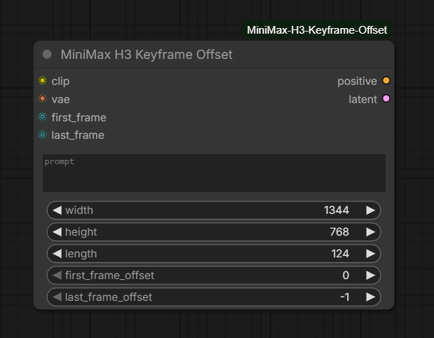

# ComfyUI MiniMax H3 Keyframe Offset & Voice Studio

**[English](README.md) · [Русский](README_RU.md)**

Release target: **v2.0.0** (previous public release: v1.2.0)

Custom nodes for MiniMax H3 in ComfyUI:
1. **MiniMax H3 Keyframe Offset** — place first/last image keyframes at chosen frame indices.
2. **MiniMax H3 Voice Studio (AIO)** — one audio node with three modes: Audio Generation, Expressive TTS / Single Voice, and Expressive TTS / Dual Voice Dialogue.

## Contents
- [v2.0.0 changes](#v200-changes)
- [Screenshots](#screenshots)
- [Installation](#installation)
- [Requirements](#requirements)
- [Keyframe Offset](#1-minimax-h3-keyframe-offset)
- [Voice Studio AIO](#2-minimax-h3-voice-studio-aio)
  - [Shared connections](#shared-model-connections)
  - [Audio Generation](#mode-a--audio-generation)
  - [Expressive TTS — Single Voice](#mode-b--expressive-tts--single-voice)
  - [Voice cloning](#voice-cloning-reference-audio)
  - [Expressive TTS — Dual Voice Dialogue](#mode-c--expressive-tts--dual-voice-dialogue)
  - [Dialogue syntax](#dialogue-syntax)
  - [Language control](#language-control)
  - [Emotion and pause tags](#emotion-delivery-and-pause-tags)
  - [Tag Picker](#tag-picker)
  - [Duration profiles](#adaptive-speech-duration-engine-20)
- [Prompting tips](#prompting-tips)
- [Troubleshooting](#troubleshooting)
- [Release notes](#release-notes)

## v2.0.0 changes

The jump from v1.2.0 to v2.0.0 introduces a substantially expanded Voice Studio:

- Unified audio generation and expressive speech in **MiniMax H3 Voice Studio (AIO)**.
- Three workflows: `Audio Generation`, `Expressive TTS → Single Voice`, and `Expressive TTS → Dual Voice Dialogue`.
- Single Voice reference audio and two separate dialogue references: `speaker_1` and `speaker_2`.
- Sequential speaker-conditioned dialogue generation and assembly of utterances plus explicit pauses into one audio output.
- Inline emotion/delivery directions and `[pause=...]` tags.
- Global language selection, Custom language, and persistent per-turn `[lang=...]` overrides.
- Tag Picker buttons for speech and dialogue fields.
- Adaptive Speech Duration Engine 2.0 with `Compact`, `Balanced`, and `Expressive` profiles.
- Expanded segment report with speaker, text, language, duration estimate/alignment, sample rate, and sample count.
- Retained Keyframe Offset with native ComfyUI `minimax_keyframes` conditioning; no global `PackedLayout` monkey patch.

## Screenshots

Place the three new supplied screenshots in `docs/images/` with these exact filenames:

### 1. Audio Generation


### 2. Expressive TTS — Single Voice


### 3. Expressive TTS — Dual Voice Dialogue


### 4. Keyframe Offset


Keep the existing Keyframe Offset screenshot in `docs/images/`. If its filename is not `keyframe_offset.png`, change the path above to the existing filename (or rename the image).

## Installation

### Git clone
Run from `ComfyUI/custom_nodes/`:

```bash
git clone https://github.com/asirusasr-maker/ComfyUI-MiniMax-H3-Keyframe-Offset.git
```

Restart ComfyUI.

### ZIP
1. Download the repository using **Code → Download ZIP**.
2. Extract it into `ComfyUI/custom_nodes/`.
3. Ensure the folder is named `ComfyUI-MiniMax-H3-Keyframe-Offset`.
4. Restart ComfyUI.

Windows Portable path:

```text
ComfyUI_windows_portable/ComfyUI/custom_nodes/ComfyUI-MiniMax-H3-Keyframe-Offset/
```

For an update, stop ComfyUI, back up workflows/local changes, replace the old node folder with the new version, and restart. If a node instance does not expose new widgets, delete that instance and add the node again.

## Requirements

- ComfyUI with MiniMax H3 support.
- MiniMax H3 diffusion model and matching CLIP/text encoder.
- MiniMax H3 video VAE and audio VAE.
- For Keyframe Offset, a ComfyUI build with native support for `resolved_frame_index` in `minimax_keyframes`.

The package uses ComfyUI/PyTorch APIs. It intentionally does not patch ComfyUI core globally.

## 1. MiniMax H3 Keyframe Offset

This node injects first/last reference images into MiniMax H3 conditioning at selected frame positions.

| Input | Purpose |
|---|---|
| `clip` | MiniMax H3 text encoder. |
| `vae` | Video VAE used to encode reference frames. |
| `prompt` | Video description. |
| `width`, `height` | Output dimensions. |
| `length` | Requested frames at 24 fps; H3 temporal alignment applies. |
| `first_frame_offset` | First image position; `0` means the first frame. |
| `last_frame_offset` | Last image position; `-1` means the final frame. |
| `first_frame`, `last_frame` | Optional image references. |

Outputs: `positive` (CONDITIONING with native keyframe data) and `latent` (AV latent for the downstream H3 sampler).

Offsets are clamped to the valid aligned frame range. A clamp message is printed to the ComfyUI console. H3 length follows the `17k + 5` temporal grid at 24 fps, so a requested length can be rounded up.

Typical graph:

```text
Load Image (first) ──┐
                     ├──> MiniMax H3 Keyframe Offset ── positive ──> H3 Sampler
Load Image (last)  ──┘                  │
CLIP / Video VAE / prompt / size / length
                                        └── latent ────────────────> H3 Sampler
```

## 2. MiniMax H3 Voice Studio (AIO)

Choose the workflow with `generation_mode`. `Expressive TTS` has a second selector, `expressive_tts_mode`.

### Shared model connections

| Socket | Connect |
|---|---|
| `model` | MiniMax H3 diffusion model. |
| `clip` | MiniMax H3 text encoder. |
| `vae` | MiniMax H3 video VAE. |
| `audio_vae` | MiniMax H3 audio VAE. |
| `audio` output | ComfyUI audio preview/save node. |

Do not swap `vae` and `audio_vae`.

### Mode A — Audio Generation

Select:

```text
generation_mode = Audio Generation
```

Use this for sound effects, ambience, environmental soundscapes, and other prompt-driven audio.

| Control | Purpose |
|---|---|
| Prompt area | Describe sound sources, action, distance, atmosphere, and acoustic space. |
| `length` | Manual duration in H3 frames at 24 fps (aligned to H3 grid). |
| `seed` | Generation seed. |
| `control after generate` | Seed behavior after generation (e.g. fixed/randomize). |
| `steps` | Sampling steps. |
| `sampler_name` | Sampler. |
| `scheduler` | Scheduler. |
| `denoise` | Denoise strength; full generation normally uses `1.0`. |
| `use_references` | Enables optional Ref2VA reference sockets. |
| `ref_image` | Optional visual reference, referred to as `<Picture 1>`. |
| `ref_audio` | Optional audio reference, referred to as `<Audio 1>`. |

Example prompt:

```text
A quiet pine forest at dawn. Small birds calling from different distances,
a light breeze moving through branches, subtle leaves rustling,
natural open-air ambience, no music, no speech.
```

When using references, mention the exact tokens:

```text
<Picture 1> Create a realistic soundscape matching this location:
soft wind, distant birds, and spacious outdoor ambience.
```

```text
Use the vocal timbre and acoustic character of <Audio 1>
for a calm narrator reading a short passage.
```

`<Picture 1>` and `<Audio 1>` are reference markers. Keep the angle brackets and spelling exact.

### Mode B — Expressive TTS / Single Voice

Select:

```text
generation_mode = Expressive TTS
expressive_tts_mode = Single Voice
```

Use `speech_text` for the words to be spoken. Optional controls:

| Control | Purpose |
|---|---|
| `speech_language` | Auto, a listed language, or Custom. |
| `custom_speech_language` | Appears for Custom; enter a language such as `Uzbek`. |
| `ref_audio` | Optional voice reference for voice identity/cloning. |
| `voice_type` | General voice type guidance if no reference is connected. |
| `custom_voice_description` | Additional voice description. |
| `voice_timbre` | General timbre guidance. A connected reference should guide identity. |
| `expressive_default_style` | Default speaking style. |
| `expressive_default_emotion` | Default emotion when no local tag overrides it. |
| `expressive_default_intensity` | Default emotion intensity. |
| `expressive_default_speed` | Default pace guidance. |
| `expressive_default_pitch` | Default pitch guidance. |
| `seed`, `steps`, `sampler_name`, `scheduler`, `denoise` | Sampling controls. |

The manual `length` widget is hidden in Expressive TTS; speech duration is estimated automatically per utterance.

Example `speech_text`:

```text
[softly] I was thinking about you today.
[pause=500ms]
[happy] And I have some wonderful news!
[laughing] I still can't believe it.
```

Write the actual spoken words outside the brackets. Brackets contain instructions/tags, not the dialogue itself.

### Voice cloning / reference audio

1. Prepare a clean recording of the target voice.
2. Connect it to `ref_audio`.
3. Enter the new words in `speech_text`.
4. Select the spoken language.
5. Add emotion/delivery tags only where needed.
6. Generate and listen.

Reference tips:
- Prefer one speaker, clean speech, low background noise, and little reverberation.
- A short, neutral sample is a useful starting point.
- Reference audio guides voice characteristics; it does not guarantee a perfect clone, exact pronunciation, or word-for-word copying.
- The reference contains audio context as well as timbre. If possible, avoid music, overlapping speech, and distracting background content.

### Mode C — Expressive TTS / Dual Voice Dialogue

Select:

```text
generation_mode = Expressive TTS
expressive_tts_mode = Dual Voice Dialogue
```

Connect two separate voice references:

| Socket | Reference |
|---|---|
| `speaker_1` | Voice of the person labelled `[Speaker 1]`. |
| `speaker_2` | Voice of the person labelled `[Speaker 2]`. |

The node generates turns sequentially with the corresponding speaker reference, then assembles the speech chunks and pause segments into one audio output. Do not connect the two references to the wrong sockets.

Basic dialogue:

```text
[Speaker 1]
Hello! How are you?

[Speaker 2]
I'm doing well, thank you!
```

More expressive dialogue:

```text
[Speaker 1]
[angry] Why did you leave without telling me?

[Speaker 2]
[softly] I didn't want to hurt you.

[pause=700ms]

[Speaker 1]
[whispering] Can we talk about it?
```

Rules:
- Write `[Speaker 1]` or `[Speaker 2]` exactly, on its own line.
- The following text belongs to that speaker until another speaker label appears.
- Emotion/delivery tags go inside square brackets before the words they affect.
- A pause is a separate tag and does not switch speakers.
- Keep turns reasonably concise for more predictable duration.

## Dialogue syntax

### Speaker labels

```text
[Speaker 1]
First speaker's words.

[Speaker 2]
Second speaker's words.
```

Do not replace the labels with `Speaker 1:` or `(Speaker 1)`.

### Emotion and delivery tags

Examples:

```text
[happy] I have been waiting for this!
[sad] I miss those days.
[angry] Please stop doing that!
[whispering] Don't wake anyone.
[softly] Everything will be okay.
[shouting] Get out of here!
[laughing] That was hilarious!
[crying] I can't believe it.
[sighing] It has been a long day.
[gasping] What happened?!
```

Multiple directions can be combined where supported:

```text
[whispering, sad] I thought you would stay.
```

Tags are natural-language performance guidance, not guaranteed acoustic commands. Avoid stacking conflicting directions.

### Pause tags

Use the exact `=` syntax:

```text
[pause=300ms]
[pause=700ms]
[pause=1s]
[pause=1.2s]
[pause=2.5s]
```

`ms` means milliseconds; `s` means seconds. A pause is inserted into the assembled audio and is not spoken. Avoid ambiguous forms such as `[pause 1 second]`.

## Language control

`speech_language` sets the default language for Expressive TTS. Options include `Auto`, `English`, `Russian`, `Chinese`, `Japanese`, `Korean`, `Spanish`, `French`, `German`, `Portuguese`, `Italian`, and `Custom`. With Custom, enter the language in `custom_speech_language` (for example, `Uzbek`).

For a language change inside a Dual Voice script, use either:

```text
[lang=English]
```

or:

```text
[language=Russian]
```

The override persists for following utterances until another language tag is supplied.

Example: Russian by default, one English turn, then back to Russian:

```text
[Speaker 1]
[lang=Russian]
Привет! Как прошёл твой день?

[Speaker 2]
[lang=English]
It was great, thanks for asking.

[Speaker 1]
[lang=Russian]
Рад это слышать!
```

Place the language tag immediately after the speaker label for clarity. Language instructions guide the model but do not guarantee perfect pronunciation or eliminate all language drift.

## Emotion, delivery, and pause tags

Common directions include `[happy]`, `[sad]`, `[angry]`, `[whispering]`, `[softly]`, `[shouting]`, `[laughing]`, `[crying]`, `[sighing]`, and `[gasping]`.

Correct placement:

```text
[angry] I told you not to touch that!
```

Changing delivery within one turn:

```text
[Speaker 1]
[angry] I can't believe this happened.
[pause=400ms]
[softly] I just need a moment.
```

Do not put spoken words inside the tag brackets. Put the instruction inside brackets and the words after the closing bracket.

## Tag Picker

The node provides:
- `mm_tag_picker_speech` under the Single Voice `speech_text` field.
- `mm_tag_picker_dialogue` under the Dual Voice `dialogue_script` field.

Click the button, choose a tag/category, and it is inserted at the saved caret position. Selected text may be replaced. For a custom pause, enter a value such as `pause=2.5s`. To control insertion position, focus the text box and place the caret before opening the picker. Tags can also be typed manually.

## Adaptive Speech Duration Engine 2.0

Expressive TTS estimates duration separately for each utterance. The manual `length` control is not used in these modes.

| Profile | Behavior | Recommended use |
|---|---|---|
| `Compact` | Shorter estimated budget and smaller extra margin. | Concise lines; try this if the model adds unwanted words at the end. |
| `Balanced` | Middle-ground estimate. | General starting point for conversation. |
| `Expressive` | More time for slower or emotionally stretched delivery. | Dramatic, slow, or highly expressive lines. |

Default: `Balanced`. If extra words appear at the end, try `Compact`. If the last word is clipped or speech feels rushed, try `Balanced`/`Expressive` or slightly lower `speaking_speed_hint`.

`speaking_speed_hint` affects the estimate and provides pace guidance; it is not a precise playback-speed control. Start at `1.00` and adjust gradually.

The estimator considers approximate syllable count, punctuation, speed hint, and profile, then aligns the frame budget to H3's temporal grid.

**Limitations:** duration is a latent generation budget, not a guaranteed stop boundary. H3 can still add, omit, repeat, or alter words. Compact can reduce unwanted continuation but may clip a line ending. The segment report is diagnostic metadata, not proof of exact transcript matching.

Suggested starting point:

```text
speaking_speed_hint = 1.00
duration_profile = Balanced
steps = 20
denoise = 1.00
```

Change one setting at a time when testing.

## Prompting tips

- Write only the words intended to be spoken in the speech/dialogue field.
- Use normal punctuation and manageable utterance lengths.
- Put delivery directions in square brackets before the phrase.
- Use exact speaker labels on separate lines.
- Set the global language and add `[lang=...]` only where language changes.
- Use clean reference recordings and connect each speaker to the matching socket.
- Avoid many conflicting emotion tags in one phrase.
- If the model continues beyond the text, try `Compact` and shorten the utterance. If it clips the ending, try a less compact profile.

## Troubleshooting

| Issue | Checks |
|---|---|
| Node missing | Check startup console, folder location, Python import errors; restart ComfyUI. |
| Silent/invalid audio | Check the correct `audio_vae` and `denoise` setting. |
| Wrong dialogue voice | Verify `speaker_1` and `speaker_2` connections. |
| Two voices sound similar | Use cleaner, more distinct reference recordings; identity separation can vary by checkpoint. |
| Extra words | Try `Compact`, shorten the utterance, simplify tags. Duration is not a hard stop. |
| Last word clipped | Try `Balanced`/`Expressive` or lower `speaking_speed_hint` slightly. |
| Wrong language | Set `speech_language` explicitly and add `[lang=...]` overrides. |
| Emotion not apparent | Use one clear tag immediately before the phrase. Tags are guidance. |
| Pause read aloud | Check exact syntax, e.g. `[pause=700ms]`. |
| Tag Picker inserts in wrong place | Focus the target text field and position the caret first. |
| New widgets absent | Restart ComfyUI and re-add the node instance. |
| Keyframe offset rejected | Update ComfyUI to native `resolved_frame_index` support; this package does not patch core. |

When reporting an issue, include ComfyUI version, full traceback, selected mode, prompt/script, and segment report if available.

## Release notes

### v2.0.0
- Expanded Voice Studio AIO into Audio Generation, Expressive TTS Single Voice, and Expressive TTS Dual Voice Dialogue.
- Added voice cloning/reference audio, separate speaker references, and sequential dialogue assembly.
- Added emotion/delivery and pause tags.
- Added language selector and per-turn language overrides.
- Added Tag Picker.
- Added Adaptive Speech Duration Engine 2.0 with Compact/Balanced/Expressive profiles.
- Expanded segment diagnostics.
- Retained native, patch-free Keyframe Offset conditioning.

Previous release: `v1.2.0`. See Git tags/releases for earlier history.

## License and credits

Apache License 2.0 — see [`LICENSE`](LICENSE).

- ComfyUI and its MiniMax H3 integration.
- MiniMax for the H3 model.
- Maintainer: [asirusasr-maker](https://github.com/asirusasr-maker).

Repository: https://github.com/asirusasr-maker/ComfyUI-MiniMax-H3-Keyframe-Offset
