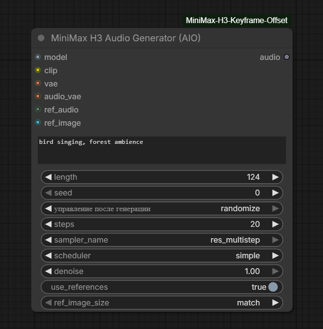

# ComfyUI-MiniMax-H3-Keyframe-Offset

[](https://github.com/comfyanonymous/ComfyUI)
[](https://www.python.org/)
[](LICENSE)
[](#patch-free-architecture)

Custom nodes that extend the **MiniMax H3** workflow in ComfyUI:

- **MiniMax H3 Keyframe Offset** — place the first and last reference frames at chosen positions inside a generated clip.
- **MiniMax H3 Audio Generator (AIO)** — generate audio in one node, with optional image and audio references using the native Ref2VA conditioning path.

The current maintenance release removes the package's former global `PackedLayout` monkey patch. Keyframe offsets are now passed through ComfyUI's native `minimax_keyframes` conditioning data.

---

## Contents

- [What's new](#whats-new)
- [Features](#features)
- [Installation](#installation)
- [Requirements](#requirements)
- [Nodes](#nodes)
  - [MiniMax H3 Keyframe Offset](#1-minimax-h3-keyframe-offset)
  - [MiniMax H3 Audio Generator (AIO)](#2-minimax-h3-audio-generator-aio)
- [Example workflows](#example-workflows)
- [Technical notes](#technical-notes)
- [Troubleshooting](#troubleshooting)
- [License](#license)
- [Credits](#credits)

---

## What's new

### Patch-free maintenance release

- **Removed the global `PackedLayout.__init__` monkey patch.** The package no longer replaces or wraps this ComfyUI core method during import.
- **Native keyframe conditioning.** `MiniMax H3 Keyframe Offset` passes frame positions through `minimax_keyframes` and each keyframe's `resolved_frame_index`.
- **Removed the extra `minimax_frame_count` conditioning entry.** The AV latent carries the target temporal dimensions.
- **Updated audio resampling.** Reference audio is resampled with ComfyUI's `comfy.audio.resample` utility instead of calling `torchaudio` directly.
- **Preserved the two node workflows.** The keyframe node keeps its offset controls; the AIO audio node retains its sampler, Ref2VA references, Audio VAE decoding, and ComfyUI `AUDIO` output.

**Why this matters:** the previous import-time patch modified a shared ComfyUI class. Because Python modules are shared by all custom nodes in the same ComfyUI process, that change could affect unrelated extensions. This release avoids that global modification.

> **Compatibility note:** this patch-free implementation requires a ComfyUI version whose native MiniMax H3 implementation supports arbitrary `resolved_frame_index` values in `minimax_keyframes`. If an older build rejects non-zero offsets, update ComfyUI. This package intentionally does not install a compatibility monkey patch.

---

## Features

| Feature | Description |
|---|---|
| Arbitrary keyframe placement | Place the first and last reference images at selected frame indices, rather than only at the clip boundaries. |
| Automatic offset clamping | Clamp offsets to the valid range of the aligned frame count. |
| External length input | Use a frame count supplied by another node; offsets are clamped against the resolved H3 frame count. |
| Native ComfyUI integration | Use native `minimax_keyframes` conditioning without modifying global ComfyUI classes or functions. |
| All-in-one audio generation | Prompt → conditioning → noise → sampling → Audio VAE decode → `AUDIO` output. |
| Ref2VA image reference | Supply an image as `<Picture 1>` to provide visual context for audio generation. |
| Ref2VA audio reference | Supply audio as `<Audio 1>` for voice/style reference. |
| Combined references | Use image and audio references together. |

---

## Installation

### Method 1 — Git clone

Open a terminal in your ComfyUI `custom_nodes` directory and run:

```bash
git clone https://github.com/asirusasr-maker/ComfyUI-MiniMax-H3-Keyframe-Offset.git
```

Restart ComfyUI after installation.

### Method 2 — Download ZIP

1. Download the repository using **Code → Download ZIP**.
2. Extract the folder into `ComfyUI/custom_nodes/`.
3. Make sure the resulting folder is named `ComfyUI-MiniMax-H3-Keyframe-Offset`.
4. Restart ComfyUI.

### Windows Portable

The folder should be located at:

```text
ComfyUI_windows_portable/
└── ComfyUI/
    └── custom_nodes/
        └── ComfyUI-MiniMax-H3-Keyframe-Offset/
```

### Updating from an older patched version

For a clean update:

1. Stop ComfyUI completely.
2. Back up any local changes or workflows stored inside the old node folder.
3. Remove the old `ComfyUI-MiniMax-H3-Keyframe-Offset` folder.
4. Install the current repository version.
5. Start ComfyUI again.

A full restart is important: it clears the Python process in which an older version may already have installed its monkey patch.

---

## Requirements

- A working installation of ComfyUI with native MiniMax H3 support.
- The MiniMax H3 model components required by your workflow, including the diffusion model, text encoder/CLIP, video VAE, and audio VAE as applicable.
- A Python environment supported by your ComfyUI installation.

This custom-node package uses ComfyUI and PyTorch APIs and does not require additional third-party Python packages. The package's `requirements.txt` is intentionally minimal.

**No patch installer is included or required.** Do not add a separate patch to `comfy/` or modify ComfyUI core files for this package.

---

## Nodes

Node screenshots are available in [`docs/images/`](docs/images/).

### 1. MiniMax H3 Keyframe Offset


A conditioning node for MiniMax H3 image-to-video workflows. It allows the first and last reference images to be injected at user-selected frame positions.

A typical workflow pins:

- the first image to frame `0`;
- the last image to the final frame.

With this node, you can move either reference image to another position. The model can generate motion before the first reference, between the references, and after the last reference, depending on their selected positions.

#### Inputs

| Input | Type | Description |
|---|---|---|
| `clip` | `CLIP` | MiniMax H3 text encoder. |
| `vae` | `VAE` | MiniMax H3 video VAE used to encode reference frames. |
| `prompt` | `STRING` | Text prompt; multiline and dynamic prompts are supported. |
| `width` | `INT` | Output canvas width. Default: `1344`; step: `32`. |
| `height` | `INT` | Output canvas height. Default: `768`; step: `32`. |
| `length` | `INT` | Requested frame count at 24 fps. It is aligned to the H3 temporal grid. Default: `124` frames (about 5.2 seconds). |
| `first_frame_offset` | `INT` | Frame index for `first_frame`. `0` means the first frame. |
| `last_frame_offset` | `INT` | Frame index for `last_frame`. `-1` means the final frame. |
| `first_frame` | `IMAGE` (optional) | First reference image. |
| `last_frame` | `IMAGE` (optional) | Last reference image. |

#### Outputs

| Output | Type | Description |
|---|---|---|
| `positive` | `CONDITIONING` | Positive conditioning containing native `minimax_keyframes` data when reference images are connected. |
| `latent` | `LATENT` | Empty AV NestedTensor latent for the downstream sampler. |

#### Offset behavior

- `last_frame_offset = -1` resolves to `frame_count - 1`.
- Both offsets are clamped to the valid range `[0, frame_count - 1]`.
- If a value is clamped, the node prints the adjustment in the ComfyUI console.
- The first reference image is resized to the canvas with `disabled` crop mode.
- The last reference image is resized using `center` crop mode.
- Each encoded keyframe is passed using `resolved_frame_index` in the native `minimax_keyframes` conditioning field.

Example console message:

```text
[MiniMax H3 Keyframe Offset] Offsets clamped to [0, 123]: first_frame_offset 200->123, last_frame_offset 150->123
```

#### Typical connection

```text
Load Image (first) ──┐
                     ├──> MiniMax H3 Keyframe Offset
Load Image (last)  ──┘             │
                                   ├── positive ──> Sampler
CLIP ──────────────────────────────┤
Video VAE ─────────────────────────┤
Prompt / Width / Height / Length ──┘
                                   └── latent ────> Sampler
```

Connect the node's `positive` conditioning and `latent` output to the corresponding inputs of your MiniMax H3 sampling workflow.

---

### 2. MiniMax H3 Audio Generator (AIO)



An all-in-one MiniMax H3 audio generation node. It handles conditioning, noise preparation, sampling, Audio VAE decoding, and returns a ComfyUI-compatible `AUDIO` value. Separate sampler and decode nodes are not needed for this audio path.

The node also supports optional Ref2VA-style image and audio references.

#### Inputs

| Input | Type | Description |
|---|---|---|
| `model` | `MODEL` | MiniMax H3 diffusion model. |
| `clip` | `CLIP` | MiniMax H3 text encoder. |
| `vae` | `VAE` | MiniMax H3 video VAE used for AV latent/reference handling. |
| `audio_vae` | `VAE` | MiniMax H3 audio VAE used to encode audio references and decode generated audio. |
| `prompt` | `STRING` | Audio description. With references enabled, refer to them as `<Picture 1>` and `<Audio 1>`. |
| `length` | `INT` | Duration control in frames at 24 fps, aligned to the H3 temporal grid. Default: `124` (about 5.2 seconds). |
| `seed` | `INT` | Noise seed. |
| `steps` | `INT` | Sampling steps. Default: `20`. |
| `sampler_name` | `COMBO` | Sampler selection. Default: `res_multistep`. |
| `scheduler` | `COMBO` | Scheduler selection. Default: `simple`. |
| `denoise` | `FLOAT` | Denoise strength from `0.0` to `1.0`. Default: `1.0`. |
| `use_references` | `BOOLEAN` | Enables the optional Ref2VA reference inputs. |
| `ref_image_size` | `COMBO` | Image reference sizing: `match` or `max`. |
| `ref_image` | `IMAGE` (optional) | Visual reference exposed as `<Picture 1>` in the prompt. |
| `ref_audio` | `AUDIO` (optional) | Audio reference exposed as `<Audio 1>` in the prompt. |

#### Output

| Output | Type | Description |
|---|---|---|
| `audio` | `AUDIO` | ComfyUI audio object containing a waveform and sample rate. |

The output is normalized to a ComfyUI audio dictionary with a waveform tensor shaped as `[B, C, L]` and a sample rate of 32 kHz. It can be connected to ComfyUI audio preview and save nodes.

#### Reference modes

Enable `use_references` to expose the `ref_image` and `ref_audio` inputs.

**Audio reference — voice or style**

1. Connect a short reference recording to `ref_audio`.
2. Enable `use_references`.
3. Refer to the audio reference in the prompt using `<Audio 1>`.

Example:

```text
A calm narrator reads a short passage in a warm, intimate voice. <Audio 1>
```

The reference provides audio/voice characteristics for the model to use when generating new audio. It does not mean that the node simply returns or copies the input recording.

**Image reference — visual context**

1. Connect an image to `ref_image`.
2. Enable `use_references`.
3. Refer to it in the prompt using `<Picture 1>`.

Example:

```text
<Picture 1> Create the soundscape of this location: soft wind, distant birds, and a spacious natural ambience.
```

The image can provide scene context for sound generation.

**Combined image and audio references**

Connect both references and mention both tokens:

```text
<Picture 1> A mysterious voice whispers in this environment. Use the vocal character of <Audio 1>.
```

A visual reference is recommended when using `ref_audio`, as the native H3 reference path may produce weaker voice-reference results without an image anchor.

#### Internal generation path

The AIO node performs the following operations:

1. Creates the AV latent structure for the requested duration.
2. Encodes optional image and audio references when reference mode is enabled.
3. Tokenizes the prompt and builds native H3 conditioning.
4. Prepares the sampler and scheduler sigmas.
5. Prepares noise and calls ComfyUI's custom sampling path.
6. Decodes the audio latent with the supplied Audio VAE.
7. Returns a ComfyUI `AUDIO` object.

MiniMax H3 is guidance-distilled in this workflow; CFG is fixed at `1.0` and is not exposed as a UI input.

---

## Example workflows

Example workflow JSON files are included in [`example_workflow/`](example_workflow/):

- `Minimax_h3_keyframe_offset.json`
- `minimax_h3_audio_generator.json`

### Suggested audio-reference prompt

```text
A female narrator speaks clearly and naturally, with a warm and expressive delivery. <Audio 1>
```

### Suggested image-guided sound prompt

```text
<Picture 1> Generate a realistic ambience that matches this scene: subtle environmental details, natural spatial depth, and believable reverberation.
```

Load the example JSON into ComfyUI and connect the model components from your own MiniMax H3 installation.

---

## Technical notes

### H3 frame alignment

The node aligns the requested frame count to the MiniMax H3 temporal grid (`17k + 5`). The generated duration is based on the aligned frame count at 24 fps.

Examples:

| Requested frames | Aligned frames | Approx. duration at 24 fps |
|---:|---:|---:|
| 124 | 124 | 5.17 s |
| 200 | 209 | 8.71 s |
| 362 | 362 | 15.08 s |

The audio latent uses a 40 Hz temporal rate and is decoded to 32 kHz audio.

### Patch-free architecture

This package does **not**:

- monkey-patch `comfy.ldm.minimax.model.PackedLayout.__init__`;
- replace or wrap ComfyUI core classes or methods;
- alter global ComfyUI settings or functions at import time;
- install a runtime compatibility patch.

Keyframe positions are supplied through the native `minimax_keyframes` conditioning field. This keeps the package's keyframe behavior local to its own conditioning output rather than changing shared ComfyUI behavior for every custom node.

### Compatibility

Use a current ComfyUI version with native MiniMax H3 support and native handling of `resolved_frame_index` in `minimax_keyframes`.

Because this release deliberately avoids monkey patches, it does not attempt to retrofit older ComfyUI versions that lack this native behavior. Updating ComfyUI is the recommended solution for an older installation.

---

## Troubleshooting

| Problem | What to check |
|---|---|
| Nodes do not appear | Check the ComfyUI startup console for import errors. Confirm the package folder is directly inside `ComfyUI/custom_nodes/`, then restart ComfyUI. |
| Non-zero keyframe offsets are rejected | Update ComfyUI to a build with native MiniMax H3 support for arbitrary `resolved_frame_index` values. This package intentionally does not patch the core. |
| Offset is different from the requested value | The node clamps offsets to the valid range of the aligned frame count. Check the console for the clamp message. |
| Audio output is silent or invalid | Confirm that the MiniMax H3 Audio VAE is connected to `audio_vae`, and check the denoise value. For full generation, use `denoise = 1.0`. |
| Voice reference is weak | Try a clean, short reference recording and connect a suitable `ref_image` as an additional visual anchor. |
| Reference inputs are not visible | Enable `use_references`; the optional `ref_image` and `ref_audio` inputs are exposed for reference mode. |
| A node behaves differently after updating | Stop ComfyUI completely, remove the old node folder, install the new version, and restart. Re-add the node to the workflow if its input layout changed. |

When reporting an issue, include your ComfyUI version, the full startup/ execution traceback, and which of the two nodes is involved.

---

## License

This project is licensed under the [Apache License 2.0](LICENSE).

## Credits

- [ComfyUI](https://github.com/comfyanonymous/ComfyUI) and the ComfyUI MiniMax H3 integration.
- MiniMax for the H3 model architecture.
- Built and maintained by [asirusasr-maker](https://github.com/asirusasr-maker).

Repository: https://github.com/asirusasr-maker/ComfyUI-MiniMax-H3-Keyframe-Offset
