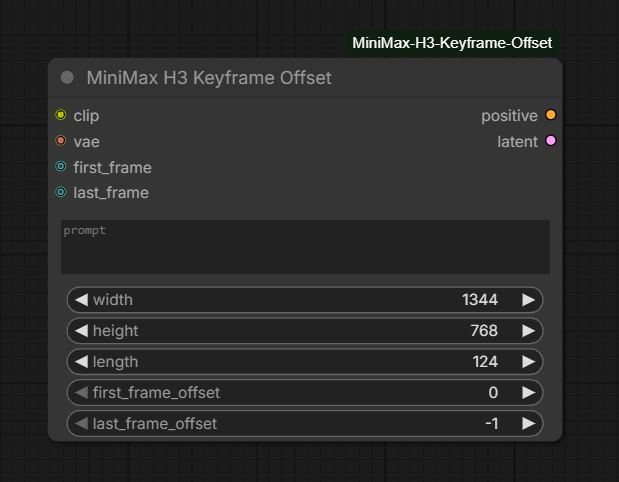

# ComfyUI MiniMax H3 Keyframe Offset & Voice Studio

[English](README.md) · **[Русский](README_RU.md)**

**Целевая версия релиза:** `v2.0.0` (предыдущий публичный релиз: `v1.2.0`)

Пользовательские ноды ComfyUI для MiniMax H3:

1. **MiniMax H3 Keyframe Offset** — размещение первого и последнего референсных изображений в выбранных кадрах клипа.
2. **MiniMax H3 Voice Studio (AIO)** — универсальная нода с тремя режимами: Audio Generation, Expressive TTS / Single Voice и Expressive TTS / Dual Voice Dialogue.

## Содержание
- [Что нового в v2.0.0](#что-нового-в-v200)
- [Скриншоты](#скриншоты)
- [Установка](#установка)
- [Требования](#требования)
- [Keyframe Offset](#1-minimax-h3-keyframe-offset)
- [Voice Studio AIO](#2-minimax-h3-voice-studio-aio)
  - [Общие подключения](#общие-подключения-моделей)
  - [Audio Generation](#режим-a--audio-generation)
  - [Expressive TTS — Single Voice](#режим-b--expressive-tts--single-voice)
  - [Клонирование голоса](#клонирование-голоса-и-аудиореференс)
  - [Expressive TTS — Dual Voice Dialogue](#режим-c--expressive-tts--dual-voice-dialogue)
  - [Синтаксис диалога](#синтаксис-диалога)
  - [Управление языком](#управление-языком)
  - [Теги эмоций и пауз](#теги-эмоций-подачи-и-пауз)
  - [Tag Picker](#tag-picker)
  - [Профили длительности](#adaptive-speech-duration-engine-20)
- [Рекомендации по промптам](#рекомендации-по-промптам)
- [Решение проблем](#решение-проблем)
- [История релизов](#история-релизов)

## Что нового в v2.0.0

Переход с v1.2.0 на v2.0.0 включает большое расширение Voice Studio:

- Объединение генерации аудио и выразительной речи в **MiniMax H3 Voice Studio (AIO)**.
- Три сценария: `Audio Generation`, `Expressive TTS → Single Voice`, `Expressive TTS → Dual Voice Dialogue`.
- Один аудиореференс для Single Voice и два независимых референса для диалога: `speaker_1` и `speaker_2`.
- Последовательная генерация реплик с референсом соответствующего спикера и сборка фрагментов/пауз в одну аудиодорожку.
- Встроенные теги эмоций и манеры речи, синтаксис пауз `[pause=...]`.
- Выбор общего языка, Custom language и постоянные переопределения языка `[lang=...]` для отдельных реплик.
- Кнопки Tag Picker для полей речи и диалога.
- Adaptive Speech Duration Engine 2.0 с профилями `Compact`, `Balanced`, `Expressive`.
- Расширенный отчёт сегментов: спикер, текст, язык, оценка длительности и выравнивание, sample rate и число сэмплов.
- Сохранена Keyframe Offset с нативным conditioning ComfyUI `minimax_keyframes`, без глобального monkey patch `PackedLayout`.

## Скриншоты

Поместите три новых изображения в `docs/images/`, сохранив точные имена файлов:

### 1. Audio Generation


### 2. Expressive TTS — Single Voice


### 3. Expressive TTS — Dual Voice Dialogue


### 4. Keyframe Offset


Сохраните существующий скриншот Keyframe Offset в `docs/images/`. Если его имя отличается от `keyframe_offset.png`, измените путь выше на фактическое имя файла либо переименуйте изображение.

## Установка

### Через Git

Выполните команду из папки `ComfyUI/custom_nodes/`:

```bash
git clone https://github.com/asirusasr-maker/ComfyUI-MiniMax-H3-Keyframe-Offset.git
```

После установки перезапустите ComfyUI.

### Через ZIP

1. На GitHub выберите **Code → Download ZIP**.
2. Распакуйте репозиторий в `ComfyUI/custom_nodes/`.
3. Проверьте, что папка называется `ComfyUI-MiniMax-H3-Keyframe-Offset`.
4. Перезапустите ComfyUI.

Путь для Windows Portable:

```text
ComfyUI_windows_portable/ComfyUI/custom_nodes/ComfyUI-MiniMax-H3-Keyframe-Offset/
```

Для обновления остановите ComfyUI, сохраните workflow и локальные изменения, замените старую папку новой версией и запустите ComfyUI. Если старый экземпляр ноды не показывает новые элементы, удалите его из графа и добавьте ноду заново.

## Требования

- ComfyUI с поддержкой MiniMax H3.
- Диффузионная модель MiniMax H3 и соответствующий CLIP/text encoder.
- Video VAE и Audio VAE MiniMax H3.
- Для Keyframe Offset нужна версия ComfyUI с нативной поддержкой `resolved_frame_index` в `minimax_keyframes`.

Пакет использует API ComfyUI/PyTorch. Глобальные патчи ядра ComfyUI не устанавливаются.

## 1. MiniMax H3 Keyframe Offset

Эта нода добавляет первое и последнее референсные изображения в conditioning MiniMax H3 на заданных позициях видеоклипа.

| Вход | Назначение |
|---|---|
| `clip` | Текстовый энкодер MiniMax H3. |
| `vae` | Video VAE для кодирования референсных кадров. |
| `prompt` | Описание видео. |
| `width`, `height` | Размер выходного изображения/кадра. |
| `length` | Запрошенная длина в кадрах при 24 fps; применяется выравнивание H3. |
| `first_frame_offset` | Позиция первого изображения; `0` — первый кадр. |
| `last_frame_offset` | Позиция последнего изображения; `-1` — последний кадр. |
| `first_frame`, `last_frame` | Необязательные изображения-референсы. |

Выходы: `positive` (CONDITIONING с нативными данными ключевых кадров) и `latent` (AV latent для последующего H3 sampler).

Смещения ограничиваются допустимым диапазоном выровненного количества кадров. Информация об изменении выводится в консоль ComfyUI. Длина H3 подчиняется временной сетке `17k + 5` при 24 fps, поэтому запрошенное значение может быть округлено вверх.

Пример графа:

```text
Load Image (first) ──┐
                     ├──> MiniMax H3 Keyframe Offset ── positive ──> H3 Sampler
Load Image (last)  ──┘                  │
CLIP / Video VAE / prompt / size / length
                                        └── latent ────────────────> H3 Sampler
```

## 2. MiniMax H3 Voice Studio (AIO)

Сценарий выбирается через `generation_mode`. У `Expressive TTS` есть дополнительный переключатель `expressive_tts_mode`.

### Общие подключения моделей

| Сокет | Что подключить |
|---|---|
| `model` | Диффузионная модель MiniMax H3. |
| `clip` | Текстовый энкодер MiniMax H3. |
| `vae` | Video VAE MiniMax H3. |
| `audio_vae` | Audio VAE MiniMax H3. |
| Выход `audio` | Нода ComfyUI для прослушивания/сохранения аудио. |

Не меняйте местами `vae` и `audio_vae`.

### Режим A — Audio Generation

Выберите:

```text
generation_mode = Audio Generation
```

Режим предназначен для звуковых эффектов, атмосфер, окружающих звуков и других задач генерации аудио по промпту.

| Параметр | Назначение |
|---|---|
| Поле Prompt | Опишите источники звука, действия, расстояние, атмосферу и акустическое пространство. |
| `length` | Ручная длительность в кадрах H3 при 24 fps; значение выравнивается по сетке H3. |
| `seed` | Seed генерации. |
| `control after generate` | Поведение seed после генерации (например, fixed/randomize). |
| `steps` | Количество шагов сэмплирования. |
| `sampler_name` | Sampler. |
| `scheduler` | Scheduler. |
| `denoise` | Сила денойзинга; для полной генерации обычно `1.0`. |
| `use_references` | Включает дополнительные входы Ref2VA. |
| `ref_image` | Необязательный визуальный референс, обозначаемый `<Picture 1>`. |
| `ref_audio` | Необязательный аудиореференс, обозначаемый `<Audio 1>`. |

Пример промпта:

```text
A quiet pine forest at dawn. Small birds calling from different distances,
a light breeze moving through branches, subtle leaves rustling,
natural open-air ambience, no music, no speech.
```

Если используются референсы, указывайте точные токены:

```text
<Picture 1> Create a realistic soundscape matching this location:
soft wind, distant birds, and spacious outdoor ambience.
```

```text
Use the vocal timbre and acoustic character of <Audio 1>
for a calm narrator reading a short passage.
```

`<Picture 1>` и `<Audio 1>` — маркеры референсов. Сохраняйте угловые скобки и точное написание.

### Режим B — Expressive TTS / Single Voice

Выберите:

```text
generation_mode = Expressive TTS
expressive_tts_mode = Single Voice
```

В `speech_text` вводится текст, который должен произнести один голос.

| Параметр | Назначение |
|---|---|
| `speech_language` | Auto, один из доступных языков или Custom. |
| `custom_speech_language` | Появляется при Custom; укажите язык, например `Uzbek`. |
| `ref_audio` | Необязательный аудиореференс для идентичности/клонирования голоса. |
| `voice_type` | Общее описание типа голоса, если референс не подключён. |
| `custom_voice_description` | Дополнительное текстовое описание голоса. |
| `voice_timbre` | Общее описание тембра. Подключённый референс должен быть главным источником идентичности. |
| `expressive_default_style` | Стиль речи по умолчанию. |
| `expressive_default_emotion` | Эмоция по умолчанию, если локальный тег её не переопределяет. |
| `expressive_default_intensity` | Интенсивность эмоции. |
| `expressive_default_speed` | Подсказка по скорости. |
| `expressive_default_pitch` | Подсказка по высоте голоса. |
| `seed`, `steps`, `sampler_name`, `scheduler`, `denoise` | Параметры сэмплирования. |

В Expressive TTS ручной параметр `length` скрыт: длительность оценивается автоматически для каждой реплики.

Пример `speech_text`:

```text
[softly] I was thinking about you today.
[pause=500ms]
[happy] And I have some wonderful news!
[laughing] I still can't believe it.
```

Пишите произносимые слова вне квадратных скобок. В скобках находятся инструкции/теги, а не сам текст речи.

### Клонирование голоса и аудиореференс

1. Подготовьте чистую запись нужного голоса.
2. Подключите её к `ref_audio`.
3. Введите новый текст в `speech_text`.
4. Выберите язык речи.
5. Добавьте теги эмоций/подачи только там, где это необходимо.
6. Запустите генерацию и прослушайте результат.

Советы:
- Желательно использовать запись одного человека, без фоновой музыки и сильного шума.
- Короткий нейтральный образец — хорошая отправная точка.
- Референс помогает передать характеристики голоса, но не гарантирует идеальное клонирование, точное произношение или дословное копирование.
- В аудиореференсе есть не только тембр, но и речевой контекст. По возможности избегайте музыки, наложения голосов и отвлекающего фонового содержимого.

### Режим C — Expressive TTS / Dual Voice Dialogue

Выберите:

```text
generation_mode = Expressive TTS
expressive_tts_mode = Dual Voice Dialogue
```

Подключите два отдельных голосовых референса:

| Сокет | Референс |
|---|---|
| `speaker_1` | Голос участника, обозначенного `[Speaker 1]`. |
| `speaker_2` | Голос участника, обозначенного `[Speaker 2]`. |

Нода последовательно генерирует реплики с соответствующим референсом спикера, а затем объединяет речевые фрагменты и паузы в одну аудиодорожку. Не перепутайте подключения.

Базовый диалог:

```text
[Speaker 1]
Hello! How are you?

[Speaker 2]
I'm doing well, thank you!
```

Диалог с эмоциями:

```text
[Speaker 1]
[angry] Why did you leave without telling me?

[Speaker 2]
[softly] I didn't want to hurt you.

[pause=700ms]

[Speaker 1]
[whispering] Can we talk about it?
```

Правила:
- Пишите `[Speaker 1]` или `[Speaker 2]` точно в таком виде, на отдельной строке.
- Следующий текст принадлежит этому спикеру, пока не появится другая метка.
- Теги эмоций/подачи ставьте в квадратных скобках перед словами.
- Пауза — отдельный тег, она не переключает спикера.
- Для более предсказуемой длительности не делайте реплики чрезмерно длинными.

## Синтаксис диалога

### Метки спикеров

```text
[Speaker 1]
Текст первого участника.

[Speaker 2]
Текст второго участника.
```

Не заменяйте метки на `Speaker 1:` или `(Speaker 1)`.

### Теги эмоций и подачи

Примеры:

```text
[happy] I have been waiting for this!
[sad] I miss those days.
[angry] Please stop doing that!
[whispering] Don't wake anyone.
[softly] Everything will be okay.
[shouting] Get out of here!
[laughing] That was hilarious!
[crying] I can't believe it.
[sighing] It has been a long day.
[gasping] What happened?!
```

Несколько направлений можно объединить, если они поддерживаются:

```text
[whispering, sad] I thought you would stay.
```

Теги являются естественно-языковыми подсказками модели, а не гарантированными акустическими командами. Не объединяйте много противоречащих друг другу инструкций.

### Теги пауз

Используйте точный синтаксис с `=`:

```text
[pause=300ms]
[pause=700ms]
[pause=1s]
[pause=1.2s]
[pause=2.5s]
```

`ms` — миллисекунды, `s` — секунды. Пауза вставляется в итоговое аудио и не произносится. Не используйте неоднозначные формы вроде `[pause 1 second]`.

## Управление языком

`speech_language` задаёт язык по умолчанию для Expressive TTS. Варианты: `Auto`, `English`, `Russian`, `Chinese`, `Japanese`, `Korean`, `Spanish`, `French`, `German`, `Portuguese`, `Italian`, `Custom`. Для Custom укажите язык в `custom_speech_language`, например `Uzbek`.

Чтобы сменить язык внутри Dual Voice Dialogue, используйте:

```text
[lang=English]
```

или:

```text
[language=Russian]
```

Переопределение действует на последующие реплики, пока не будет задан другой языковой тег.

Пример: русский язык по умолчанию, одна английская реплика, затем снова русский:

```text
[Speaker 1]
[lang=Russian]
Привет! Как прошёл твой день?

[Speaker 2]
[lang=English]
It was great, thanks for asking.

[Speaker 1]
[lang=Russian]
Рад это слышать!
```

Для ясности ставьте языковой тег сразу после метки спикера. Языковые инструкции направляют модель, но не гарантируют идеальное произношение и полное отсутствие смешения языков.

## Теги эмоций, подачи и пауз

Распространённые направления: `[happy]`, `[sad]`, `[angry]`, `[whispering]`, `[softly]`, `[shouting]`, `[laughing]`, `[crying]`, `[sighing]`, `[gasping]`.

Правильное размещение:

```text
[angry] I told you not to touch that!
```

Изменение подачи внутри одной реплики:

```text
[Speaker 1]
[angry] I can't believe this happened.
[pause=400ms]
[softly] I just need a moment.
```

Не помещайте произносимые слова внутрь скобок. В скобках пишется инструкция, а слова — после закрывающей скобки.

## Tag Picker

В ноде есть:
- `mm_tag_picker_speech` под полем `speech_text` в Single Voice.
- `mm_tag_picker_dialogue` под полем `dialogue_script` в Dual Voice Dialogue.

Нажмите кнопку, выберите тег/категорию — тег вставится в сохранённую позицию курсора. Выделенный текст может быть заменён. Для пользовательской паузы укажите, например, `pause=2.5s`. Чтобы контролировать место вставки, сначала активируйте текстовое поле и установите курсор. Теги также можно вводить вручную.

## Adaptive Speech Duration Engine 2.0

Expressive TTS отдельно рассчитывает длительность каждой реплики. Ручной `length` в этих режимах не используется.

| Профиль | Поведение | Когда использовать |
|---|---|---|
| `Compact` | Более короткий бюджет и меньший дополнительный запас. | Короткие реплики; попробуйте, если модель добавляет лишние слова в конце. |
| `Balanced` | Средний расчёт длительности. | Универсальная отправная точка для разговора. |
| `Expressive` | Больше времени для медленной или эмоционально растянутой речи. | Драматичные, медленные или очень выразительные реплики. |

По умолчанию используется `Balanced`. Если в конце появляются лишние слова, попробуйте `Compact`. Если последнее слово обрезается или речь слишком торопливая, попробуйте `Balanced`/`Expressive` либо немного уменьшите `speaking_speed_hint`.

`speaking_speed_hint` влияет на расчёт и служит подсказкой по темпу; это не точное управление скоростью воспроизведения. Начните с `1.00` и меняйте постепенно.

Расчёт учитывает приблизительное количество слогов, пунктуацию, скорость и профиль, после чего количество кадров выравнивается по временной сетке H3.

**Ограничения:** длительность — это бюджет latent-генерации, а не гарантированная граница остановки. H3 всё ещё может добавить, пропустить, повторить или изменить слова. Compact может уменьшить нежелательное продолжение, но иногда обрезает конец фразы. Отчёт сегментов — диагностические данные, а не доказательство точного совпадения с текстом.

Рекомендуемые стартовые значения:

```text
speaking_speed_hint = 1.00
duration_profile = Balanced
steps = 20
denoise = 1.00
```

При тестировании меняйте по одному параметру за раз.

## Рекомендации по промптам

- В поле речи/диалога пишите только слова, которые должны прозвучать.
- Используйте обычную пунктуацию и разумную длину реплик.
- Инструкции подачи размещайте в квадратных скобках перед фразой.
- Метки спикеров пишите точно и на отдельных строках.
- Установите общий язык и используйте `[lang=...]` только там, где язык меняется.
- Используйте чистые референсы и подключайте каждого участника к соответствующему входу.
- Не перегружайте одну фразу противоречивыми эмоциями.
- Если модель продолжает фразу лишними словами, попробуйте `Compact` и сократите реплику. Если обрезает окончание — выберите менее компактный профиль.

## Решение проблем

| Проблема | Что проверить |
|---|---|
| Нода не появляется | Проверьте консоль запуска, путь к папке, ошибки импорта Python; перезапустите ComfyUI. |
| Аудио пустое/некорректное | Проверьте `audio_vae` и `denoise`. |
| Неправильный голос в диалоге | Проверьте подключения `speaker_1` и `speaker_2`. |
| Голоса похожи | Используйте более чистые и различающиеся референсы; разделение идентичности зависит от checkpoint. |
| Лишние слова | Попробуйте `Compact`, сократите реплику, упростите теги. Длительность не является жёсткой командой остановки. |
| Обрезается последнее слово | Попробуйте `Balanced`/`Expressive` или немного уменьшите `speaking_speed_hint`. |
| Неправильный язык | Явно задайте `speech_language` и используйте `[lang=...]`. |
| Эмоция не выражена | Используйте один ясный тег непосредственно перед фразой. Теги — подсказки. |
| Пауза произносится | Проверьте синтаксис, например `[pause=700ms]`. |
| Tag Picker вставляет не туда | Сначала активируйте поле и установите курсор. |
| Новые параметры не видны | Перезапустите ComfyUI и добавьте экземпляр ноды заново. |
| Ошибка keyframe offset | Обновите ComfyUI до версии с нативной поддержкой `resolved_frame_index`; пакет не патчит ядро. |

При сообщении об ошибке приложите версию ComfyUI, полный traceback, выбранный режим, prompt/script и segment report, если он есть.

## История релизов

### v2.0.0
- Voice Studio AIO расширена тремя режимами: Audio Generation, Expressive TTS Single Voice и Expressive TTS Dual Voice Dialogue.
- Добавлены клонирование голоса/аудиореференс, отдельные референсы спикеров и последовательная сборка диалога.
- Добавлены теги эмоций/подачи и пауз.
- Добавлен выбор языка и переопределения языка для отдельных реплик.
- Добавлен Tag Picker.
- Добавлен Adaptive Speech Duration Engine 2.0 с профилями Compact/Balanced/Expressive.
- Расширена диагностика сегментов.
- Сохранено нативное Keyframe Offset conditioning без monkey patch.

Предыдущий релиз: `v1.2.0`. Историю более ранних версий см. в Git tags/releases.

## Лицензия и благодарности

Apache License 2.0 — см. [`LICENSE`](LICENSE).

- ComfyUI и интеграция MiniMax H3.
- MiniMax за модель H3.
- Разработчик и сопровождающий: [asirusasr-maker](https://github.com/asirusasr-maker).

Репозиторий: https://github.com/asirusasr-maker/ComfyUI-MiniMax-H3-Keyframe-Offset
